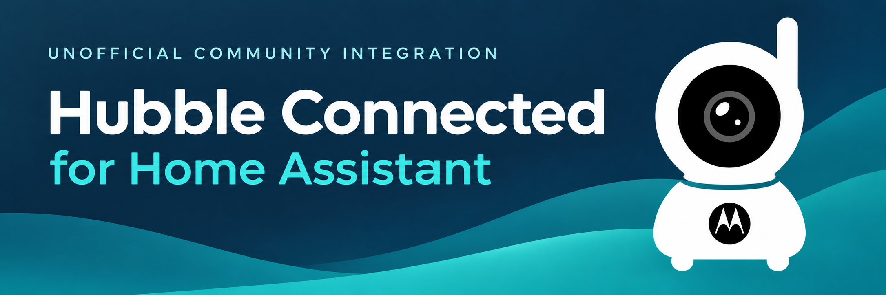

# Hubble Connected for Home Assistant

View your Hubble, Luvion or Motorola baby camera in Home Assistant. On supported
models you can also check the room temperature, change night vision and adjust
the picture from the camera's device page.

This independent integration is in beta. Check your exact model before installing
and keep the official app available while you try it.
[Find your camera and its features](https://github.com/jingle-jew/hubble-connected-home-assistant/wiki/Devices-and-features)

<!-- ha-marketplace:exclude-start -->
## Install

Use Home Assistant 2026.8 or later, with the camera on the same local network.

1. In **Home Assistant 2026.11 or later**, open **Settings → Marketplace → Add from link**.
   On earlier supported versions, open **HACS → ⋮ → Custom repositories**.
2. Paste `https://github.com/jingle-jew/hubble-connected-home-assistant`
   and choose **Integration** if asked.
3. Open **Hubble Connected**, enable pre-release versions to see the beta,
   then install or download it and restart Home Assistant.

[Detailed installation, manual setup and updates](https://github.com/jingle-jew/hubble-connected-home-assistant/wiki/Installation-and-configuration)
<!-- ha-marketplace:exclude-end -->

## Add your camera

1. Open **Settings → Devices & services → Add integration → Hubble Connected**.
2. Choose **Hubble Connected/HubbleClub for Partners** for account discovery.
   For a compatible local-only camera, choose the same option and leave the sign-in fields blank.
3. Follow the prompts, then open the camera from its Home Assistant device page.

For a HubbleClub 7101, sign in and leave the optional registration ID blank.
Home Assistant can find the camera through your account's subscriptions.
[7101 video and feature support](COMPATIBLE_DEVICES.md#hubbleclub-7101)

### Motorola VM85CONNECT (manual)

Choose **Motorola VM85CONNECT (manual)** for this model.
[Prepare the camera details and add your VM85CONNECT](https://github.com/jingle-jew/hubble-connected-home-assistant/wiki/Motorola-VM85CONNECT-setup)

## How it connects

Tested legacy cameras can stream directly on your local network. Other models
use an internet service to establish a connection and then send video locally.
After setup, Home Assistant can open the stream without your phone.

## Documentation

- [Motorola VM85CONNECT manual setup and credential helper](docs/vm85-credentials.md)

- [Installation and configuration](https://github.com/jingle-jew/hubble-connected-home-assistant/wiki/Installation-and-configuration)
- [Devices and features](https://github.com/jingle-jew/hubble-connected-home-assistant/wiki/Devices-and-features)
- [Connections and protocols](https://github.com/jingle-jew/hubble-connected-home-assistant/wiki/Connections-and-protocols)
- [Troubleshooting and diagnostics](https://github.com/jingle-jew/hubble-connected-home-assistant/wiki/Troubleshooting-and-diagnostics) · [FAQ](https://github.com/jingle-jew/hubble-connected-home-assistant/wiki/FAQ)
- [Development and contributing](https://github.com/jingle-jew/hubble-connected-home-assistant/wiki/Development-and-contributing)

## Community

[Report a problem or a model result](https://github.com/jingle-jew/hubble-connected-home-assistant/issues/new/choose) · [Contribute](CONTRIBUTING.md) · [Report a security concern privately](SECURITY.md)

Released under the [MIT License](LICENSE). This project is independent of the
camera manufacturers. [Trademark notice](NOTICE.md)
